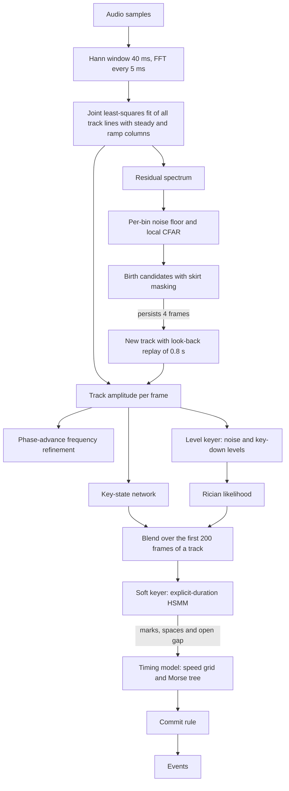
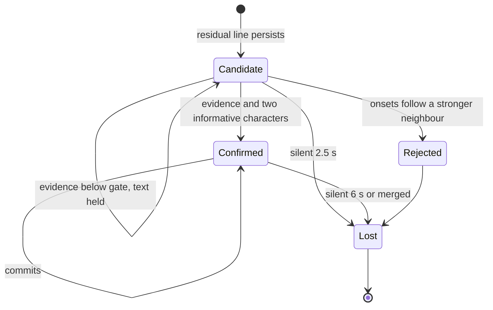
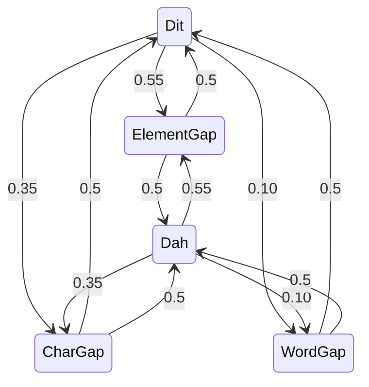
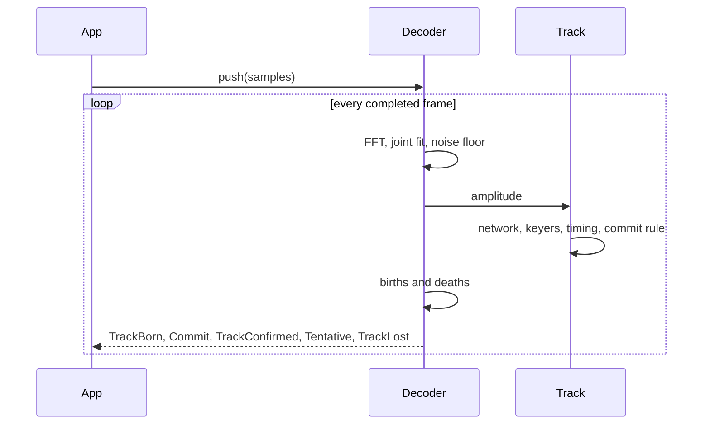
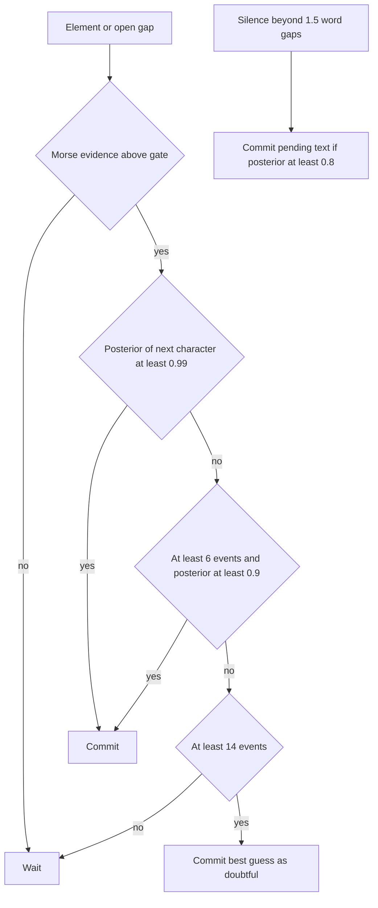

rumo
====


rumo is a streaming Morse decoder library that reads every station in the audio band at once.

## Get Started

```toml
[dependencies]
rumo = { git = "https://github.com/nextzlog/rumo" }
```

```rust
let mut dec = rumo::Decoder::new(48000);
for block in audio.chunks(128) {
    for event in dec.push(block) {
        if let rumo::Event::Commit { freq, text, .. } = event {
            println!("{freq:.0} Hz: {text}");
        }
    }
}
let tail = dec.flush();
```

## Build

```sh
$ cargo build --release
$ cargo test
```

## Events

| Event | Fields | Meaning |
|---|---|---|
| TrackBorn | freq, candidate | A new track appears. |
| TrackConfirmed | freq | The candidate is a station. |
| Commit | freq, text, chars | Confirmed characters, never revised. |
| Tentative | held, text, pattern, guess, p, alts | Uncommitted state of a track. |
| Correction | retract, text | Reserved. |
| TrackLost | candidate | The track ended. |

Every event carries the track number and the sample index of its decision.

## Algorithm

Audio samples become events in 5 ms frames.



The key-state network turns seven features per track and frame into a key-down likelihood.


A track is a candidate until its keying is shown to be Morse from a real station.



The soft keyer chains forced stages per element type and ends each chain with a geometric tail.



Each block of samples is processed frame by frame, and the events are returned in order.



A character is committed when its posterior is high enough or when it has waited long enough.



## License

### Author

- JG1VPP
- JS2FVO

### Clauses

[MIT License](LICENSE)
