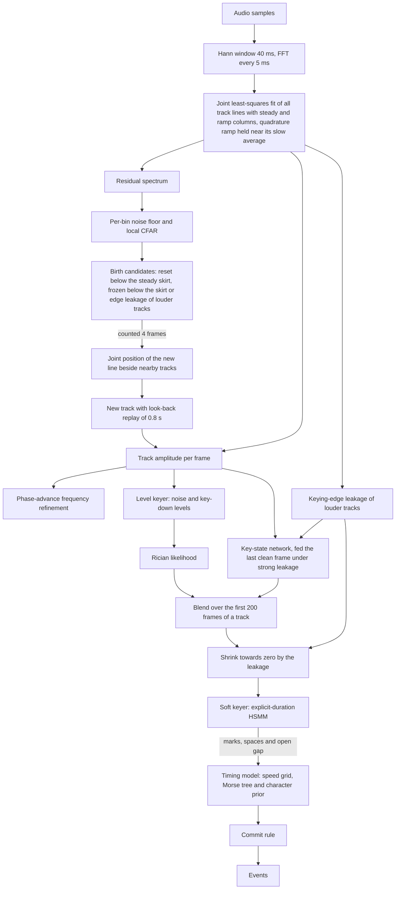
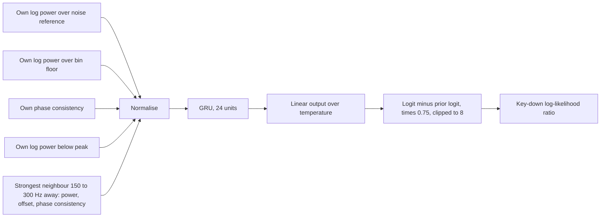
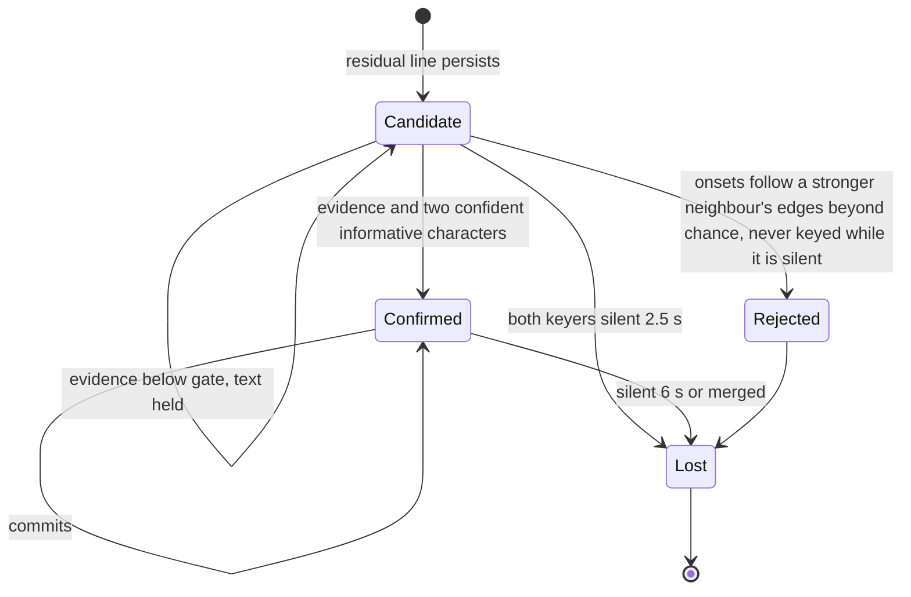
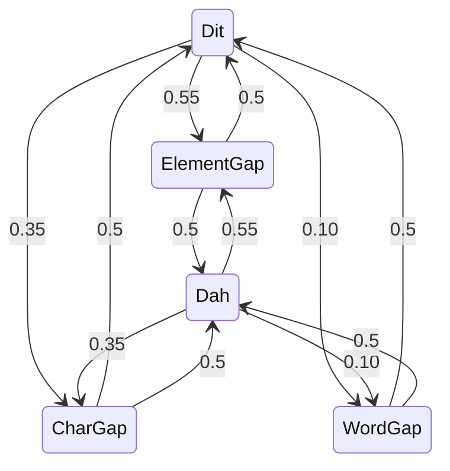
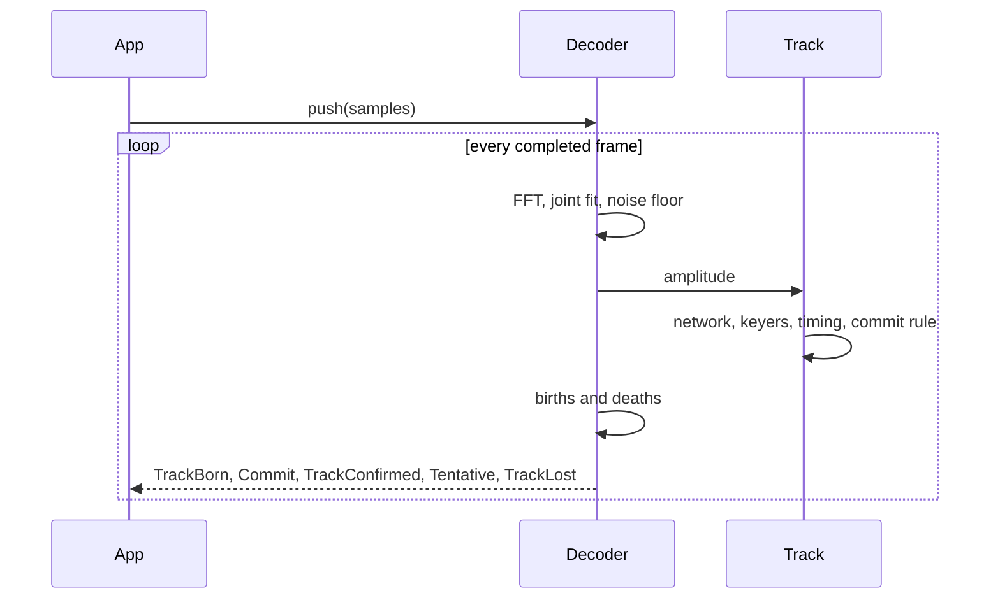
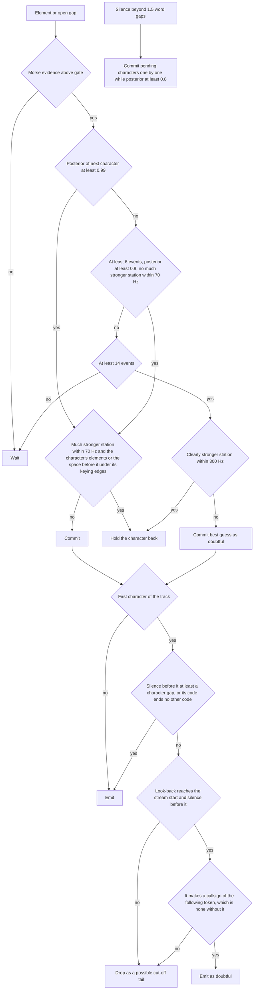
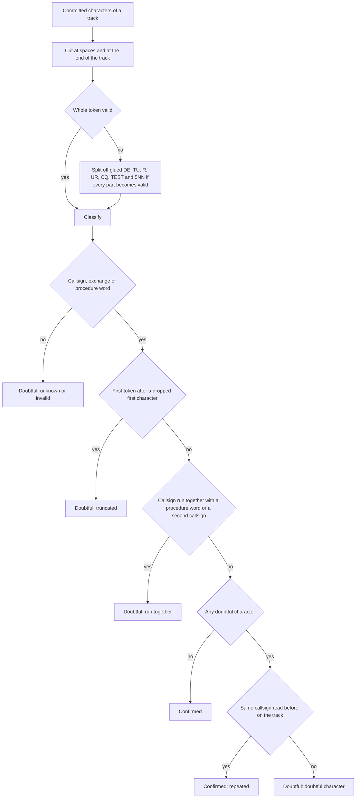

rumo
====


rumo is a streaming Morse decoder library that reads every station in the audio band at once.

## Get Started

```toml
[dependencies]
rumo = { git = "https://github.com/nextzlog/rumo" }
```

```rust
let mut dec = rumo::Decoder::new(48000);
for block in audio.chunks(128) {
    for event in dec.push(block) {
        if let rumo::Event::Commit { freq, text, .. } = event {
            println!("{freq:.0} Hz: {text}");
        }
    }
}
let tail = dec.flush();
```

## Build

```sh
$ cargo build --release
$ cargo test
```

## Events

| Event | Fields | Meaning |
|---|---|---|
| TrackBorn | freq, candidate | A new track appears. |
| TrackConfirmed | freq | The candidate is a station. |
| Commit | freq, text, chars | Confirmed characters, never revised. |
| Tentative | held, text, pattern, guess, p, alts | Uncommitted state of a track. |
| Token | start, text, kind, verdict | A closed token of committed text with its syntax verdict. |
| Correction | retract, text | Reserved. |
| TrackLost | candidate | The track ended. |

Every event carries the track number and the sample index of its decision.

## Algorithm

Audio samples become events in 5 ms frames.



The key-state network turns seven features per track and frame into a key-down likelihood.
Its neighbour inputs describe only a neighbour beyond the 150 Hz reach of keying-edge leakage, because a closer one made it follow the neighbour's keying; closer neighbours are handled by the joint fit, the edge leakage model and the common-fate checks.



A track is a candidate until its keying is shown to be Morse from a real station.



The soft keyer chains forced stages per element type and ends each chain with a geometric tail.



Each block of samples is processed frame by frame, and the events are returned in order.



A character is committed when its posterior is high enough or when it has waited long enough.



The Morse tree carries a character prior: at each node the next dit or dah, and continuing or ending the character, are weighted by tempered character frequencies, so that ambiguous gaps favour whole, likely characters.
On a track that a confirmed station at least 6 dB stronger within 300 Hz outshines, the prior is switched off, because there it turns spurious elements into confident characters, and doubtful characters are held back.
When that station is at least 10 dB stronger and within 70 Hz, a character is committed only at the full threshold of 0.99, and a character is held back and not learnt from when one of its element boundaries lies within two frames of the station's keying edges or when the space before it or within it holds such an edge, which may have erased a mark.
At the start of the stream, a first character after a short silence may be the tail of a character that was cut off; it is kept, as doubtful, only if it makes a callsign of the token that follows, which is none without it.

A keying edge of a strong station leaks into its neighbours, most strongly 40 to 60 Hz away (about 16 dB below its key-down level in the worst frame of a 40 ms window).
The decoder estimates this leakage per frame from the share of the key-down amplitude in the window and its change from the previous frame, and uses it in three places: a birth candidate that the leakage could explain is frozen instead of counted, the key-down likelihood of a weaker track is shrunk by one plus the leakage over its key-down power, and the key-state network sees the last clean frame while the leakage exceeds a tenth of that power.
The ramp column of each line is split into an in-phase part, which follows keying edges freely, and a quadrature part, which models a frequency error and is held near its slow average, so that the ramp no longer takes up a neighbour 25 to 50 Hz away whose beat rotates from frame to frame.
A new line is placed where it best explains the last four spectra together with the lines and ramps of nearby tracks, because its residual peak is pushed away from a strong neighbour.
A candidate whose onsets coincide with a stronger neighbour's edges is rejected as a ghost only if the coincidence clearly exceeds the chance rate given by the density of those edges, and never if it was key-down in at least ten frames, and a tenth of the frames, in which all its louder neighbours were silent.

## Tokens

Committed characters are never changed, but each closed token gets a verdict that tells whether it can be shown as confirmed.



A callsign has a prefix of one letter of the B F G I K M N R W series or two characters, one area digit and a suffix of one to four letters.
Japanese prefixes JA to JS take a suffix of two or three letters, 7K to 7N take area 1 to 4 and three letters, and JD takes area 1.
A prefix before a slash and a portable digit, P, M, MM, AM, A, QRP or country prefix after it are accepted.
An exchange is a report such as 5NN or 599, or a number with cut digits and at least one real digit, ended by at most one power letter P, L, M or H.
No callsign database is used.

## License

### Author

- JG1VPP
- JS2FVO

### Clauses

[MIT License](LICENSE)
